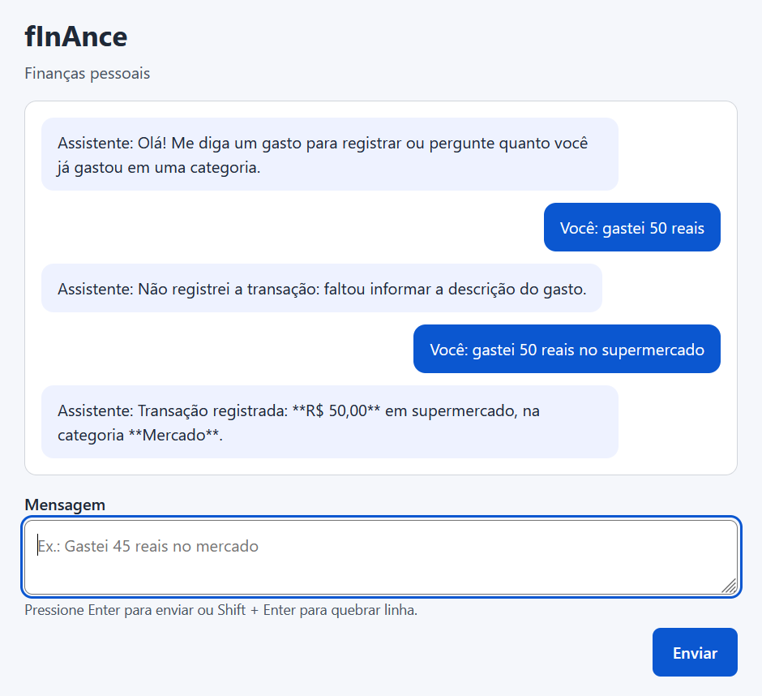

# fInAnce - Assistente Financeiro com Spring AI

## Introdução

Este projeto é uma evolução do módulo oficial da DIO: https://github.com/digitalinnovationone/dio-spring-boot-learning-track/tree/main/05-spring-ai  
A base é uma API de orçamento pessoal utilizando Spring Boot e Spring AI. Minhas evoluções adicionam validações, uma nova ferramenta de resumo e um chat web ligado à API para permitir o uso também por mensagem de texto.

## O que foi evoluído no projeto

1. Validação de domínio (`InvalidTransactionException` em `Transaction`).
2. Tratamento para devolver erro `400 Bad Request` (`GlobalExceptionHandler`).
3. Restrição no prompt (`system-message.st`) para não inventar dados faltantes.
4. Nova `@Tool` de resumo (`SummarizeTransactionsByCategoryUseCase`) + rota `/transactions/{category}/total`, além da rota `/transactions/ai/text` + interface `index.html`.
5. Mudança do modelo de chat de `gpt-4o-mini` para `gpt-6-luna` com `reasoning-effort=none`, pois o `gpt-4o-mini` está em depreciação e o `gpt-6-luna` exige `reasoning_effort=none` para *function tools* em `/v1/chat/completions`. Já o `gpt-4o-mini-tts` foi mantido porque o `TextToSpeechModel` do Spring AI usa a rota `/v1/audio/speech`, que não aceita os modelos Realtime/Live.

## Endpoints disponíveis

### GET
- `/` — Abre a interface web do chat (`fInAnce`).
- `/transactions/{category}` — Lista as transações de uma categoria (`GROCERIES`, `PHARMA` ou `AUTO`).
- `/transactions/{category}/total` — Retorna o resumo da categoria (`category`, `transactionCount` e `totalAmountInCents`).

### POST
- `/transactions` — Cria uma transação via JSON (`description`, `category` e `amount` em centavos). Retorna `201 Created` ou `400 Bad Request` se houver erro de validação.
- `/transactions/ai` — Recebe um áudio (`multipart/form-data`, campo `file`), transcreve, aciona a IA com as `@Tool`s e devolve a resposta em áudio (`audio/mp3`).
- `/transactions/ai/text` — Recebe JSON (`{"message": "..."}`), aciona a IA com as `@Tool`s e devolve JSON (`{"reply": "..."}`). Retorna `400 Bad Request` se `message` vier nula ou vazia.

## Chat Web



## Melhorias Futuras

1. **Testes unitários:** cobrir as regras de validação do domínio e o caso de uso `SummarizeTransactionsByCategoryUseCase` com mocks, sem depender da API da OpenAI.
2. **Banco de dados na nuvem:** criar um perfil de configuração para conectar a um banco gerenciado sem exigir Docker rodando localmente.
3. **Deploy:** publicar a aplicação (API + chat web) em um serviço na nuvem.
4. **Expansão de categorias:** adicionar novas opções no enum `Category` (além de `GROCERIES`, `PHARMA` e `AUTO`) e ajustar prompts e testes.
5. **Modelos de áudio/voz:** explorar transcrição local (como Whisper local) e planejar a substituição do `gpt-4o-mini-tts` (descontinuação prevista pela OpenAI para janeiro de 2027).
6. **Polimento no chat web (`index.html`):** adicionar upload/gravação de áudio direto na interface.

## Contexto do Código

O projeto processa comandos de voz (e agora também de texto) para criar e consultar transações financeiras.

Fluxo principal:

1. O cliente envia um arquivo de áudio (ou mensagem de texto).
2. No fluxo de voz, o áudio é transcrito para texto.
3. O modelo seleciona uma ferramenta/caso de uso da aplicação.
4. O caso de uso persiste ou consulta os dados da transação.
5. A resposta final é convertida em áudio (no fluxo de voz) ou retornada em JSON (no fluxo de texto).

## Estrutura do Projeto

- `src/main/java/dio/budgeting/domain`
  - Modelo de domínio e contrato do repositório.
- `src/main/java/dio/budgeting/application`
  - Casos de uso utilizados tanto pela camada REST quanto pelo *tool calling* da IA.
- `src/main/java/dio/budgeting/infrastructure`
  - Adaptadores HTTP, adaptadores JPA e camada de integração.

## Tópicos Específicos do Módulo

### Speech-to-text (Áudio para texto)

- Utiliza `TranscriptionModel` para transcrição de áudio.
- As configurações do modelo ficam em `application.properties`.

### Tool calling (Chamada de ferramentas)

- O `ChatClient` registra as ferramentas dos casos de uso.
- Métodos anotados com `@Tool` expõem capacidades de negócio para o modelo.

### Text-to-speech (Texto para áudio)

- O `TextToSpeechModel` gera uma saída em MP3 a partir do texto final.
- O endpoint de IA retorna o áudio gerado.

## Documentação do Spring AI

- Documentação de Referência do Spring AI: https://docs.spring.io/spring-ai/reference/index.html
- ChatModel API: https://docs.spring.io/spring-ai/reference/api/chatmodel.html
- ChatClient API: https://docs.spring.io/spring-ai/reference/api/chatclient.html
- Tools API: https://docs.spring.io/spring-ai/reference/api/tools.html
- Audio Transcriptions API: https://docs.spring.io/spring-ai/reference/api/audio/transcriptions.html
- Audio Speech API: https://docs.spring.io/spring-ai/reference/api/audio/speech.html

## Referências Compartilhadas de Arquitetura

Conceitos comuns de arquitetura estão documentados no repositório base da trilha:

- [Camadas DDD](https://github.com/digitalinnovationone/dio-spring-boot-learning-track/blob/main/README.md#ddd-layered-architecture)
- [Class vs record](https://github.com/digitalinnovationone/dio-spring-boot-learning-track/blob/main/README.md#java-class-vs-java-record-in-domain-modeling)
- [Identificadores fortemente tipados](https://github.com/digitalinnovationone/dio-spring-boot-learning-track/blob/main/README.md#strong-typed-identifiers)
- [Padrão Repository](https://github.com/digitalinnovationone/dio-spring-boot-learning-track/blob/main/README.md#repository-pattern)
- [Casos de uso e Clean Architecture](https://github.com/digitalinnovationone/dio-spring-boot-learning-track/blob/main/README.md#use-cases-and-clean-architecture)
- [Suporte ao Docker Compose em desenvolvimento](https://github.com/digitalinnovationone/dio-spring-boot-learning-track/blob/main/README.md#docker-compose-support-in-development)

## Como Executar

**Pré-requisitos:** Java 25, Docker ativo (sobe o MySQL pelo `compose.yml`) e `OPENAI_API_KEY`.

Defina sua chave e rode a aplicação:

**Windows (PowerShell):**
```powershell
$env:OPENAI_API_KEY="sua_chave_api_aqui"
.\gradlew.bat bootRun
```

**Linux / macOS:**
```bash
export OPENAI_API_KEY="sua_chave_api_aqui"
./gradlew bootRun
```

Acesse o chat web em `http://localhost:8080/`.  
Para rodar os testes: `./gradlew test` (ou `.\gradlew.bat test` no Windows).

## Notas

- Testes de integração com provedores externos exigem credenciais ativas.
